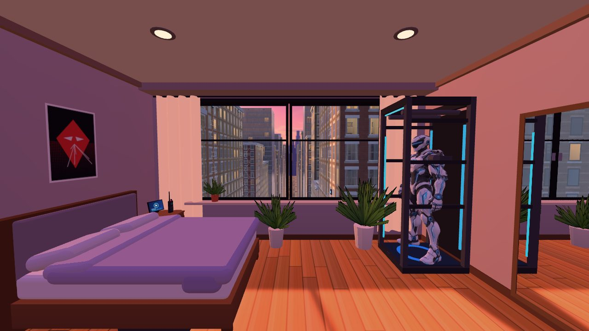
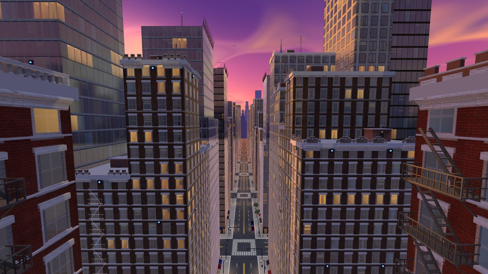
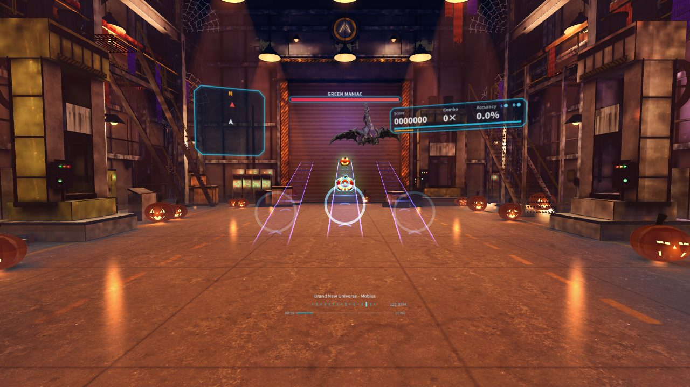
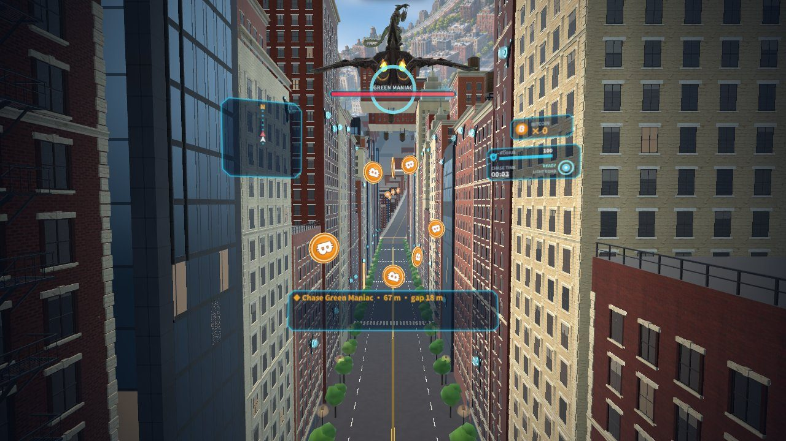

# Brand New Universe – Mobius

A VR rhythm-action game for Meta Quest 3 that runs in the headset's browser. You are Mobius, a hero in a suit of blue light: you fire light webs, throw light bombs and swing between the towers of Dala City with your bare hands, while Green Maniac rains pumpkin bombs on you from his Green Bat Jet, in time with the music. No install and no controllers needed; open a link, put your hands up and play.



## Play

**<https://bnum.magicdala.com>**

You need a Meta Quest 3 and its built-in browser.

1. Open the link in the Quest browser.
2. Wait for the status line to say the headset is ready, then press **Enter VR Game**.
3. You start in Mobius's room with a menu in front of you. Pick **Story Mode** first.

The game is played with hand tracking (controllers also work). Play standing, with room to swing your arms. Text and voice subtitles are available in English and Traditional Chinese; change the language on the title page or in the menu.

## Modes

| Mode | What it is |
| --- | --- |
| **Story Mode** (start here) | From Mobius's room out into Dala City: suit up, leave through the window, swing after Green Maniac, fight him on the factory roof and finish with a rhythm battle inside the factory. Three short tutorials teach every move along the way, and each page can be skipped. |
| **Arcade Mode** | The rhythm battle on its own. Pumpkin bombs fly down three lanes on the beat; hit each one as it reaches its ring. The hall's lights follow the music and how well you are playing. |
| **World Chase** | An endless chase through eight worlds: Foldscape City, Forest of Shadow Ruins, Redrock Canyon, Neon Tech City, Moonlit Japanese City, Cloud Palace Ancient City, Aurora Ice City and Molten Fortress. Swing between anchors, collect coins, shoot down what he throws, break his shield and bring the jet down. |



## Moves

These are the moves the in-game tutorials teach, in the order you meet them.

| Move | How to do it | Where |
| --- | --- | --- |
| Move | Pinch and hold, aim at the floor, then release to teleport. | Story (the room) |
| Turn | Swipe your thumb left or right along your index finger. | Story (the room) |
| Open the window | Push both window panes outward with your hands, then head out. | Story |
| Collect Bitcoins | Swing through the Bitcoins along the route. | Story, World Chase |
| Wall run and climb | On a wall: look where you want to run, face the wall to climb, look away to jump off. | Story |
| Light Web | Curl your middle and ring fingers, keep index and pinky out, and aim the front of your hand. At an anchor you swing; at a pumpkin bomb you destroy it. In Arcade, web each pumpkin on the beat as it reaches its ring. | All modes |
| Light Bomb | Make a fist to charge, throw forward, and open your hand to release. | All modes |
| Fan Web | Three bombs in a row: hold one palm open facing up and tap it with the little-finger edge of your other fist. | Story, Arcade |
| Light Shield | Hold an open palm toward an incoming pumpkin bomb to block it. | Story, World Chase |
| Red Target | When you see the red target on Green Maniac, fire a Light Web at it to fly in and hit him. | Story, World Chase |
| Energy Wave | Armored Pumpkin: web it on 3 beats, then bring both open palms together to blast it. | Arcade |





## Run it locally

You need Node.js 22 (see `.node-version`).

```bash
npm ci
npm run dev
```

`npm run dev` starts an HTTPS server on port 8443 and prints two addresses:

- **Local** (`https://localhost:8443/`): for a desktop browser. A WebXR emulator is added on localhost, so you can enter "VR" without a headset.
- **Network** (`https://<your-computer-LAN-IP>:8443/`): for the headset. Put the Quest and the computer on the same network, open that address in the Quest browser and accept the self-signed certificate once. WebXR needs HTTPS, which is why the dev server uses it.

The other route is a USB cable, which needs no certificate because `localhost` is a secure origin:

```bash
npm run dev:usb                  # plain HTTP on port 5173
adb reverse tcp:5173 tcp:5173    # the Quest in developer mode, connected by USB
```

Then open `http://localhost:5173/` in the Quest browser.

## Tests

```bash
npm test
```

runs the unit tests in `tests/*.test.mjs` with Node's built-in test runner. One test checks the original source models, which are not in this repository, and skips itself.

The browser tests in `tests/e2e/` drive a headless Chrome against a running dev server. They need `playwright` and a Chrome or Chromium binary, which are not dependencies of this project:

```bash
npm install --no-save playwright
npm run dev                      # in another terminal
CHROME=/path/to/chrome URL=https://localhost:8443/ node tests/e2e/smoke.e2e.mjs
```

## Build and deploy

```bash
npm run build      # writes the static site to dist/
npm run preview    # serves dist/ over HTTPS on port 8443
```

The site is fully static and is deployed on Cloudflare Pages from this repository:

| Setting | Value |
| --- | --- |
| Production branch | `main` |
| Framework preset | None |
| Build command | `npm run build` |
| Build output directory | `dist` |
| Root directory | `/` |
| Environment variables | none (the Node version comes from `.node-version`) |
| Custom domain | `bnum.magicdala.com` |

## Project layout

```
index.html            the title page
src/main.js           the app: world, state machine, hands
src/core/             i18n, settings, audio and the beat clock, charts, songs
src/input/            hand-gesture recognition and the shared input layer
src/game/             Arcade, Story, chase, combat, tutorials, effects
src/worlds/           World Chase: the eight maps, routes, streaming, rendering
src/art/              models, materials, the city, the factory, the sky
src/ui/               in-VR panels, HUD and menus
src/data/             layouts, routes and tuning tables (pure data)
src/dev/              the three *-preview.html pages used by the browser tests
public/               models, textures, audio, tutorial clips, the song chart
scripts/              chart generation and beat analysis
tests/                unit tests (*.test.mjs) and browser tests (e2e/)
docs/                 chart format, world coordinates, asset sources, the headset test checklist
```

More detail: [chart format](docs/CHART_FORMAT.md), [world coordinates](docs/WORLD_COORDINATES.md), [asset sources](docs/ASSETS.md), [Quest 3 test checklist](docs/QUEST3_TEST_CHECKLIST.md). Some of these documents are written in Traditional Chinese.

## Tech

- [three.js](https://threejs.org/) r181 (installed as `three`, aliased to `super-three@0.181.0`)
- Meta Immersive Web SDK (IWSDK) 1.0.1
- Vite 7
- WebXR with hand tracking, plain JavaScript (ES modules)

## Languages

English and Traditional Chinese.

## Assets

The original source models, music masters and gameplay recordings are not in this repository; `public/` holds the optimized copies the game loads. Where each asset comes from is recorded in [docs/ASSETS.md](docs/ASSETS.md).

Third-party material: the city and factory surface textures are made from CC0 1.0 materials from [Poly Haven](https://polyhaven.com/license) and [ambientCG](https://ambientcg.com/license).

## License

© 2026 Magic Dala. All rights reserved.
